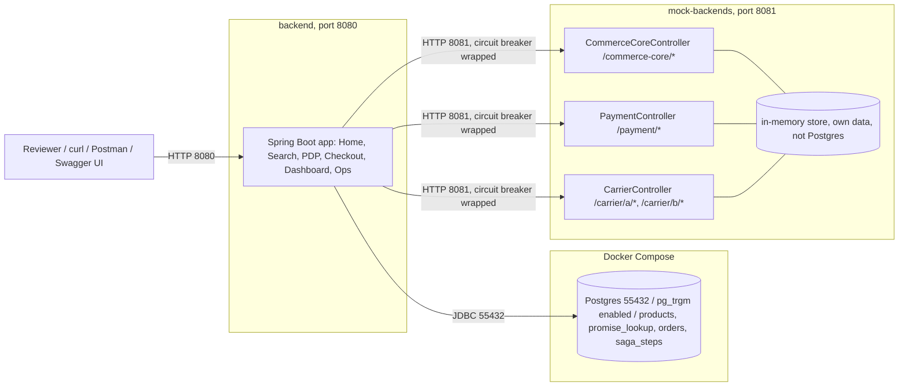
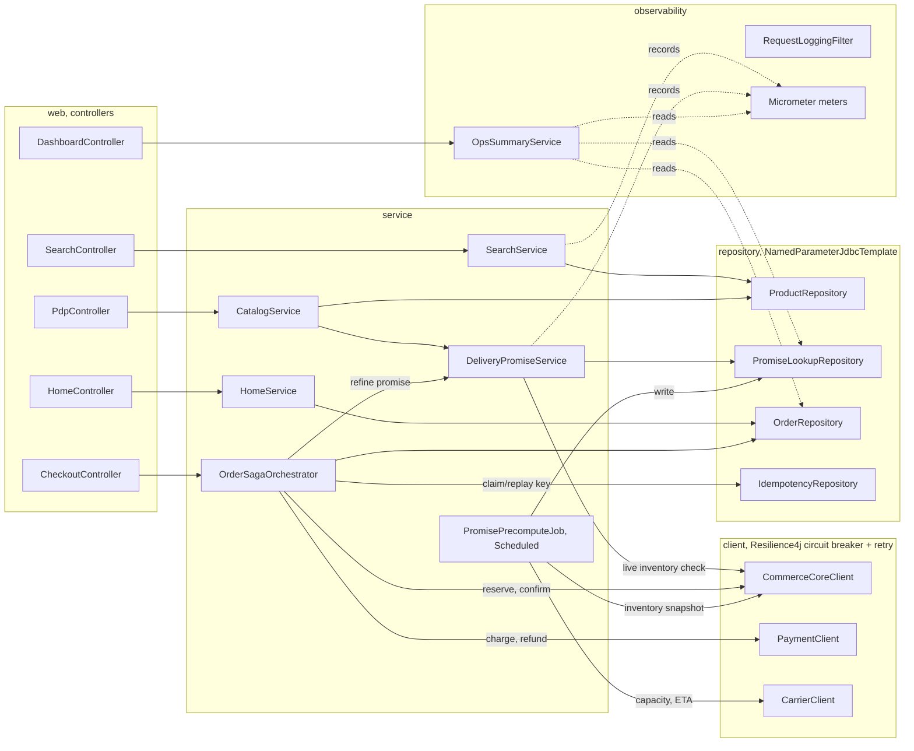
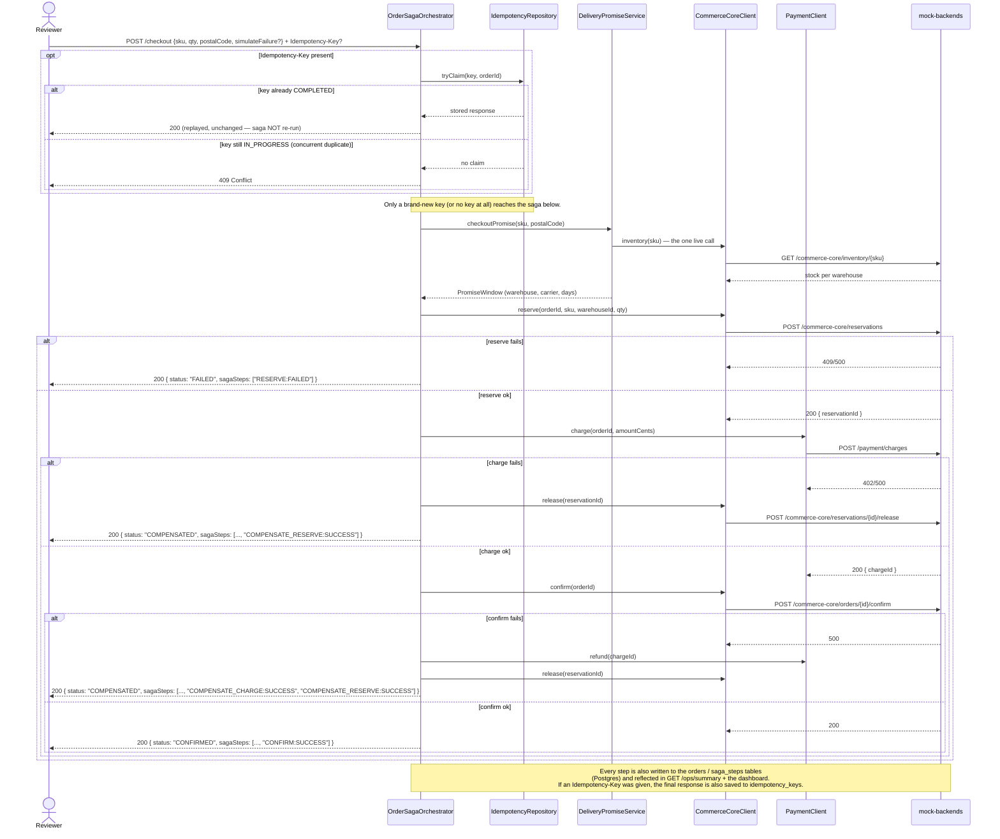

# Prototype architecture

Companion to the README's run instructions — these diagrams show what's actually in this
`sklum-backend-prototype/` directory, not the full SKLUM system design (see `SKLUM_System_Architecture` for
that; this is a zoom into Fig. 2/4/5 as they were actually built). Renders natively on GitHub,
GitLab, and most Markdown viewers (Mermaid, no extra tooling needed).

## 1. Runtime topology

What's actually running, on what port, talking to what. Postgres itself starts empty — the
backend applies schema, seed data, and indexes via Flyway on startup (see README → "Database
migrations"). This is a single Maven module (`backend/`), not split by layer — see CLAUDE.md's
"Module split" note for when that would change.



<details>
<summary>If your Mermaid renderer still shows nothing, click for a plain-text fallback</summary>

```
Reviewer (curl / Postman / Swagger UI)
        |  HTTP :8080
        v
  backend (Spring Boot, :8080) -- JDBC :55432 --> Postgres (Docker, pg_trgm)
        |
        | HTTP :8081 (circuit-breaker wrapped)
        v
  mock-backends (:8081)
    - CommerceCoreController  /commerce-core/*
    - PaymentController       /payment/*
    - CarrierController       /carrier/a/*, /carrier/b/*
    (own in-memory store, separate from Postgres)
```
</details>

## 2. Backend internal components

Same shape as the system design's Fig. 4 (which calls this the "BFF"), reflecting what was
actually coded — package names are the real `com.sklum.backend.*` packages.



## 3. Checkout saga, as a sequence

The actual control flow of `OrderSagaOrchestrator.checkout()` — every branch below has a real
test case behind it (see README → "Try the saga's compensation paths", or the Postman
collection's `simulateFailure` requests).


